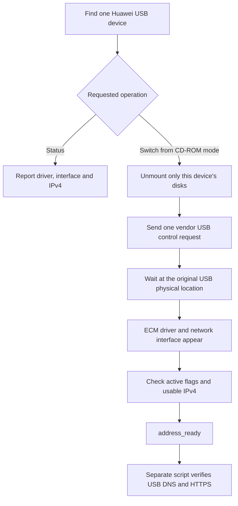

# HiLinkSwitch for macOS

**English** | [简体中文](README.zh-CN.md)

Use a **Huawei E8372h-155 HiLink modem** as a USB network interface on an Apple Silicon Mac. This tool switches the modem out of its virtual installer CD-ROM mode; networking is then handled by the **ECM driver included with macOS**.

Tested on an **M4 Mac mini running macOS 15.1.1**. The project includes a native arm64 command-line tool, a user LaunchAgent, and diagnostic scripts for the original remote-access environment. It does not install a custom kernel extension or replace Apple's network driver.

> **Before installing:** manual status/switch commands discover the USB interface dynamically. However, the diagnostic scripts and `install.sh` depend on the original NoMachine network. Read [Remote-access guard](#remote-access-guard) before using them on another Mac.

## Contents

- [Compatibility and requirements](#compatibility-and-requirements)
- [Quick start](#quick-start)
- [Commands, states, and exit codes](#commands-states-and-exit-codes)
- [USB connectivity checks](#usb-connectivity-checks)
- [Remote-access guard](#remote-access-guard)
- [Automatic switching](#automatic-switching)
- [Uninstallation](#uninstallation)
- [How it works](#how-it-works)
- [Troubleshooting](#troubleshooting)
- [Project layout](#project-layout)
- [Validation and limitations](#validation-and-limitations)
- [Origin and license](#origin-and-license)

## Compatibility and requirements

| Item | Current scope |
| --- | --- |
| Tested Mac / OS | M4 Mac mini; macOS 15.1.1, build `24B2091` |
| Tested modem | Huawei E8372h-155; HiLink firmware `21.335.03.02.233` |
| USB ID eligible for a switch request | `12d1:1f01` only |
| Observed USB ID / driver after switching | `12d1:14db` / `AppleUserECM` |
| Build output | Native `arm64`; no Intel or universal binary |
| Build tools | Xcode Command Line Tools: `xcrun clang`, macOS SDK, `codesign` |
| Diagnostics | Python 3, standard library only; installer/tests use `/usr/bin/python3` |
| Privileges | Current logged-in user; no `sudo`; installer/uninstaller reject root |

The macOS 12.0 deployment target in `build.sh` is a compiler setting, **not evidence of compatibility testing on every macOS release from 12 onward**. Other Macs, OS versions, modem models, firmware versions, and Intel builds are unverified. AT-command/PPP “stick” firmware is outside the current scope.

If Command Line Tools are missing:

```sh
xcode-select --install
```

The program links Apple's IOKit, CoreFoundation, and DiskArbitration frameworks. No Homebrew package, third-party Python package, legacy Huawei installer, firmware update, or system-security change is required.

## Quick start

Clone and build/test the source. A private repository requires access permission.

```sh
git clone https://github.com/cphust/huawei-hilink-macos.git
cd huawei-hilink-macos
sh test.sh
sh status.sh
```

`test.sh` builds the program, runs policy tests, and checks shell, Python, and plist syntax. It does not switch hardware, install a job, or test Internet access. For a build alone, run `sh build.sh`.

Connect one supported modem. If status reports `state=cdrom`, close files open on its virtual CD or memory card, then request one switch:

```sh
./build/hilink-switch --switch
sh status.sh
```

Example successful output; the interface, address, and location are illustrative, not required values:

```text
state=address_ready
devices=1
usb_id=12d1:14db
location=0x01120000
driver=AppleUserECM
interface=en9
ipv4=192.168.8.170
internet=not_tested
```

`address_ready` means an ECM driver, one network interface, active interface flags, and a usable IPv4 address were found under the same USB device. The address check excludes zero, loopback, and IPv4 link-local addresses; it does not inspect the DHCP lease. **It does not prove Internet access or that other applications use USB.** Status is read-only and always reports `internet=not_tested`.

`sh status.sh` returns nonzero when the modem is absent or not ready; this is an expected diagnostic result. If already ready, `--switch` exits without sending another control request.

## Commands, states, and exit codes

| Command | Behavior |
| --- | --- |
| `./build/hilink-switch` | Same read-only query as `--status` |
| `./build/hilink-switch --status` | Reports USB, driver, interface, and IPv4 state; no network requests |
| `./build/hilink-switch --switch` | Attempts one switch or waits for an enumerating device; 60-second overall limit |
| `./build/hilink-switch --launchd` | LaunchAgent entry point; registers the event-stream handler before switching/checking |
| `sh status.sh` | Calls the built program with `--status` |

| `state` | Meaning |
| --- | --- |
| `query_error` | USB enumeration/query failed |
| `absent` | No matching Huawei device; also possible during re-enumeration |
| `ambiguous` | Multiple Huawei USB devices or multiple network interfaces under the selected device |
| `cdrom` | Supported installer-mode ID `12d1:1f01` |
| `unsupported` | A network interface exists without the expected ECM driver |
| `waiting_driver` | Waiting for an ECM driver under a non-CD-ROM device |
| `waiting_interface` | ECM driver exists, but the network interface has not appeared |
| `waiting_address` | Interface is not active or has no acceptable IPv4 address |
| `address_ready` | Driver, interface, active flags, and IPv4 checks passed |

Initial discovery counts all Huawei devices with vendor ID `12d1`; another Huawei device can make the result ambiguous even if it is not an E8372h-155. After switching, the program follows the original USB physical location. Disappearance alone is never success.

| Exit code | Meaning |
| --- | --- |
| `0` | Address/interface ready; also used by `--launchd` when no device is present initially |
| `1` | System query, disk preparation, or unmount failed |
| `2` | Invalid arguments |
| `3` | No Huawei device during the initial query |
| `4` | Ambiguous device/interface selection |
| `5` | Not ready, unsupported, or timed out |
| `75` | Another switching instance holds the lock, or the per-user lock cannot be acquired |

These tables describe the C executable. Wrapper scripts can also fail during build, verification, or installation. `--switch` may print initial and final status blocks to stdout; progress and errors go to stderr.

## USB connectivity checks

Review the [remote-access guard](#remote-access-guard) first:

```sh
python3 snapshot.py artifacts/before.json
python3 check.py --output artifacts/check.jsonl
python3 check.py --duration 600 --output artifacts/stability.jsonl
python3 snapshot.py artifacts/after.json
```

Use a new filename for every run. Both scripts refuse to overwrite existing output. Files are created with mode `0600`; newly created evidence directories use `0700`. `artifacts/` and `build/` are ignored by Git.

`check.py` performs these steps:

1. Requires `address_ready` and verifies the fixed remote-access guard.
2. Reads the selected USB interface's DHCP router and DNS server.
3. Binds each IPv4 socket to that USB interface with macOS `IP_BOUND_IF`, and to its IPv4 address.
4. Sends an HTTP `HEAD` request to the modem gateway.
5. Queries the DHCP DNS server directly for IPv4 addresses, verifies a scoped USB route, and sends an HTTPS `HEAD` request to a returned address. TLS certificate and hostname verification remain enabled.
6. Tries `www.apple.com.cn`, then `www.baidu.com` if necessary, using up to two returned IPv4 addresses per host. These requests do not use environment proxies or the system DNS resolver.

The script accepts a valid HTTP response with a status below 500, including redirects and client errors. A gateway `405 Method Not Allowed` response to `HEAD` demonstrates a response, not a successful page fetch. Inspect the actual status; a successful check does not necessarily mean HTTP 200.

`--duration` accepts integer seconds from `0` to `600`; `0` means one check. Repeated checks are scheduled every 60 seconds and at the requested endpoint. Network processing can extend wall-clock time. The first failed round returns nonzero; earlier successful JSONL records remain. This is a low-traffic connectivity check, not a speed test.

`snapshot.py` records service configuration/order, routes, DNS, interface state, NoMachine connections, and USB status, including command return codes. It does not restore or edit settings. A saved snapshot with failed queries is not proof that the queried state is correct.

Raw evidence can include private IP addresses, service identifiers, and connection details. Keep it local and share a reviewed, redacted summary when reporting a problem.

## Remote-access guard

The reference Mac was operated through NoMachine. These assumptions are embedded in the current source:

| Source | Assumption |
| --- | --- |
| `check.py` | Route to `192.168.0.69` must use `en0` |
| `check.py` | `en0` must be active with `192.168.0.34/24` |
| `snapshot.py` | Records `en0`, `en1`, TCP port `4000`, and routes to `192.168.0.69` and `192.168.8.1` |
| `install.sh` | Runs `/usr/bin/python3 check.py`; a failure stops installation |

These are reference-environment conditions, **not addresses to assign to another Mac**. A different network can fail the guard while its USB modem works correctly. There are no command-line options to configure the guard.

For another deployment, first use the read-only/manual tool, then review and adapt the guard and snapshot targets to the actual remote session before running diagnostics or the installer. Preserve a verified remote path and recovery method. The USB interface and USB IPv4 address are discovered dynamically, not fixed to `en9` or the example address.

The switcher, installer, and diagnostics do not edit service priority, static IP settings, routes, DNS configuration, Wi-Fi, VPN settings, or modem firmware. macOS can automatically add a `HUAWEI_MOBILE` DHCP service after re-enumeration. USB-bound checks do not change the default route for ordinary applications.

## Automatic switching

After a successful manual switch and USB connectivity check, run as the logged-in user:

```sh
sh install.sh
```

The installer rebuilds, requires `--status` to succeed, and runs the guarded USB check before writing installation files or registering the job. It does not perform the initial manual switch. Existing same-named installations without this project's ownership marker are not overwritten.

| Item | Installed path |
| --- | --- |
| Executable | `~/Library/Application Support/HiLinkSwitch/hilink-switch` |
| Ownership marker | `~/Library/Application Support/HiLinkSwitch/.managed-by-hilink-switch` |
| LaunchAgent | `~/Library/LaunchAgents/local.hilink-switch.plist` |
| Log | `~/Library/Logs/hilink-switch.log` |

The destination directory and executable use `0700`; the marker, plist, and log use `0600`. The executable has a local ad-hoc signature, not an Apple Developer ID signature or notarization.

The LaunchAgent checks once at login and responds to insertion of `12d1:1f01`. Each invocation exits when finished; there is no permanent polling process or `KeepAlive` loop. It operates only in the current user's GUI session, not before login. Keep the corresponding background item allowed in macOS settings.

```sh
launchctl print "gui/$(id -u)/local.hilink-switch"
tail -n 40 "$HOME/Library/Logs/hilink-switch.log"
```

`state = not running`, `last exit code = 0`, and an event entry with `watching = 1` are consistent with a healthy job waiting for its next event. They do not prove physical replug, logout/login, or wake testing.

If bootstrap fails, the installer removes the plist and leaves the executable, marker, and log for diagnosis. Re-running `sh install.sh` rebuilds and rechecks a recognized installation. Installation never makes USB the preferred/default network service.

## Uninstallation

Run as the same user who installed it:

```sh
sh uninstall.sh
```

The script verifies the ownership marker, unloads the job if present, and removes the executable, marker, and plist. Source, logs, and network services created by macOS are retained. An unknown installation is untouched; an absent installation exits successfully.

A modem already in network mode can remain connected. After a later replug, this tool will no longer switch it automatically. There are no program-written network settings to restore.

## How it works



The diagram shows the successful CD-ROM path. Ambiguous selection, unmount failures, unsupported states, and timeout stop the operation.

The USB request uses `bmRequestType=0x40`, `bRequest=0xA1`, and zero `wValue`, `wIndex`, and data length. Re-enumeration can interrupt its response, so success is determined from the resulting device/interface state, not the request's return value alone.

Disk operations are limited to whole media below the selected device. Writable media is never force-unmounted. A read-only volume is eligible for force only after a “busy” result and a same-media check. A DiskArbitration permission failure falls back to `/usr/sbin/diskutil unmountDisk` on the same target, without `sudo` or force. Other preparation failures stop switching.

Manual/background switching share a nonblocking per-user file lock. It is released when the process exits; the file stays in the user's temporary directory. A 60-second alarm bounds switching, including blocked operations. The core executable itself makes no DNS or HTTP requests.

## Troubleshooting

| Symptom | What to check |
| --- | --- |
| `absent` | USB connection/power and macOS device visibility; absence during switching can be temporary |
| `ambiguous` | Disconnect additional Huawei devices; the program will not guess a target |
| Stays in `cdrom` | Run explicit `--switch`, read stderr, and close applications using its volumes |
| Unmount failed | Close open files; writable memory cards are never force-unmounted |
| `waiting_driver` / `unsupported` | Record model, firmware, USB ID, and driver association; only the listed setup is validated |
| `waiting_interface` | Check re-enumeration/driver state; a disappeared CD-ROM is insufficient |
| `waiting_address` | Check the `HUAWEI_MOBILE` DHCP/link state; the tool does not assign static IPs |
| `internet=not_tested` | Expected status output; use the separate check after reviewing its guard |
| `en0` / NoMachine mismatch | Compare the actual network to the embedded guard; do not change the Mac's IP to match the example |
| USB checks pass, applications still use Wi-Fi/VPN | Review application/default routing; the tool does not change priorities |
| HTTPS/DNS fails | Distinguish coverage, DHCP DNS, destination reachability, and routing; inspect the exact error/status |
| Automatic task looks idle | Inspect exit code, event subscription, background permission, and log; idle is normal between events |
| Exit `75` | Wait for another invocation; persistent failure can also mean an inaccessible lock path |
| Snapshot route query denied | Repeat read-only diagnostics in an authorized local Terminal if the execution environment restricts queries |

In the reference setup, `1.1.1.1:443` was unreachable while USB DNS and Apple HTTPS succeeded. One unavailable endpoint is not a conclusive USB-link test. A management `HEAD` response of 405 is also different from a failed TCP connection.

For issue reports, include Mac/OS and modem/firmware versions, redacted status/error output, and the exact command/exit code. Review logs and snapshots before sharing. The archived Spanish upstream document is not an installation guide for this adaptation.

## Project layout

| Path | Purpose |
| --- | --- |
| `hilink-switch.c` | Discovery, state classification, unmount, USB request, timeout, lock, background entry |
| `build.sh` / `status.sh` | arm64 build/signing and read-only status wrapper |
| `check.py` / `snapshot.py` | Guarded USB checks and read-only network evidence |
| `install.sh` / `uninstall.sh` | Managed installation/removal in the current user's Library |
| `local.hilink-switch.plist.in` | LaunchAgent template; installer inserts executable/log paths |
| `tests/test_policy.c` / `test.sh` | Policy tests and build/syntax checks |
| `docs/VALIDATION.md` | Validation record and outstanding acceptance tests |
| `README.zh-CN.md` | Complete Chinese guide |
| `README-ES.md` | Archived upstream Spanish guide; behavior differs |
| `LICENSE` | Original MIT license and copyright |
| `build/`, `artifacts/` | Generated files/private evidence, excluded from Git |

## Validation and limitations

The **2026-10-25** reference run switched `12d1:1f01` to `12d1:14db`, loaded `AppleUserECM`, and obtained IPv4. The retained 10-minute record contains **11 successful USB-bound DNS/HTTPS rounds**, all with HTTPS 200 and the NoMachine peer route still on `en0`. Original network-service configuration and relative order were preserved.

During GitHub preparation, the arm64 build, policy tests, shell/Python/plist checks, code-signature verification, and live read-only USB status query passed again. Installation, uninstallation, switching, and network probes were not repeated during documentation work.

Three physical replug cycles, logout/login, sleep/wake, extended operation, and isolation with Mac Wi-Fi and VPN disabled remain unverified. Other models/firmware are not covered. See the [detailed validation record](docs/VALIDATION.md) and [中文版](docs/VALIDATION.zh-CN.md).

## Origin and license

Adapted from [function0xMarki/Huawei_HiLinkSwitch_4G-Routers](https://github.com/function0xMarki/Huawei_HiLinkSwitch_4G-Routers), pinned at [`f4f0aac8d33a152cf60db53cecd555daa1d6dae1`](https://github.com/function0xMarki/Huawei_HiLinkSwitch_4G-Routers/commit/f4f0aac8d33a152cf60db53cecd555daa1d6dae1).

The original [MIT license](LICENSE) and copyright are retained. Local import baseline: `1c20fdd`; reference-device/Apple Silicon adaptation: `791c5ce`.

The adaptation adds read-only defaults, explicit state/exit reporting, ECM/interface/IPv4 readiness checks, a narrower active-switch ID, ambiguity checks, per-user locking, bounded unmount/switch handling, and guarded installation/diagnostics. Upstream Intel results are not validation of this Apple Silicon adaptation.

**English** | [简体中文](README.zh-CN.md)
