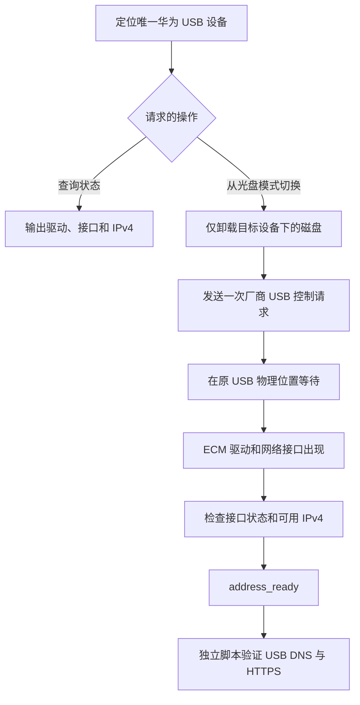

# HiLinkSwitch for macOS

[English](README.md) | **简体中文**

让 **华为 E8372h-155 HiLink 随身 WiFi** 在 Apple Silicon Mac 上作为 USB 网卡使用。本工具将设备从虚拟安装光盘模式切换到网络模式，后续联网由 **macOS 自带的 ECM 驱动**完成。

已测试环境为 **M4 Mac mini、macOS 15.1.1**。项目包含原生 arm64 命令行程序、当前用户的 LaunchAgent，以及面向原始远程连接环境的诊断脚本，无需安装自定义内核扩展或替换 Apple 网络驱动。

> **安装前请注意：**手动查询和切换会动态识别 USB 接口，但诊断脚本和 `install.sh` 依赖原始 NoMachine 网络条件。换一台 Mac 使用前，请先阅读[远程连接保护条件](#远程连接保护条件)。

## 目录

- [兼容范围与运行要求](#兼容范围与运行要求)
- [快速开始](#快速开始)
- [命令、状态与退出码](#命令状态与退出码)
- [USB 通信检查](#usb-通信检查)
- [远程连接保护条件](#远程连接保护条件)
- [安装自动切换](#安装自动切换)
- [卸载](#卸载)
- [工作原理](#工作原理)
- [常见问题](#常见问题)
- [项目结构](#项目结构)
- [验证情况与限制](#验证情况与限制)
- [来源与许可](#来源与许可)

## 兼容范围与运行要求

| 项目 | 当前范围 |
| --- | --- |
| 已测试电脑 / 系统 | M4 Mac mini；macOS 15.1.1，系统版本号 `24B2091` |
| 已测试设备 | 华为 E8372h-155；HiLink 固件 `21.335.03.02.233` |
| 允许主动发送切换请求的 USB ID | 仅 `12d1:1f01` |
| 实测切换后的 USB ID / 驱动 | `12d1:14db` / `AppleUserECM` |
| 构建产物 | 原生 `arm64`，不生成 Intel 或通用二进制 |
| 构建工具 | Xcode Command Line Tools：`xcrun clang`、macOS SDK、`codesign` |
| 诊断依赖 | Python 3，仅使用标准库；安装器和测试调用 `/usr/bin/python3` |
| 运行权限 | 当前登录用户，无需 `sudo`；安装器和卸载器拒绝 root 运行 |

`build.sh` 中的 macOS 12.0 部署目标是编译设置，**不代表已在 macOS 12 及以后所有版本上完成兼容性测试**。其他 Mac、系统、设备型号、固件和 Intel 构建尚未验证。使用 AT 指令/PPP 拨号的 “stick” 固件不属于当前范围。

如果尚未安装命令行开发工具：

```sh
xcode-select --install
```

程序链接 Apple 的 IOKit、CoreFoundation 和 DiskArbitration 框架，无需 Homebrew 软件包、第三方 Python 包、华为旧安装器、固件升级或系统安全设置调整。

## 快速开始

克隆源码并构建、测试。私有仓库需要相应访问权限。

```sh
git clone https://github.com/cphust/huawei-hilink-macos.git
cd huawei-hilink-macos
sh test.sh
sh status.sh
```

`test.sh` 会构建程序、运行策略测试，并检查 Shell、Python 和 plist 语法，不会切换硬件、安装后台任务或访问互联网。仅需构建时运行 `sh build.sh`。

连接一台支持的设备。如果状态为 `state=cdrom`，先关闭正在访问设备虚拟光盘或存储卡的文件，再执行一次切换：

```sh
./build/hilink-switch --switch
sh status.sh
```

成功状态示例如下；接口名、地址和物理位置仅为示例，不是必须使用的值：

```text
state=address_ready
devices=1
usb_id=12d1:14db
location=0x01120000
driver=AppleUserECM
interface=en9
ipv4=192.168.8.170
internet=not_tested
```

`address_ready` 表示同一 USB 设备下已发现 ECM 驱动、唯一网络接口、有效接口状态和可用 IPv4 地址。地址检查排除零地址、回环地址和 IPv4 链路本地地址，不检查 DHCP 租约。**它不代表互联网已连通，也不代表其他应用正在使用 USB。** 状态查询为只读操作，始终输出 `internet=not_tested`。

设备不存在或尚未就绪时，`sh status.sh` 返回非零退出码，这是正常诊断结果。设备已经就绪时，`--switch` 直接退出，不会再次发送控制请求。

## 命令、状态与退出码

| 命令 | 行为 |
| --- | --- |
| `./build/hilink-switch` | 与 `--status` 相同，仅查询状态 |
| `./build/hilink-switch --status` | 输出 USB、驱动、网卡和 IPv4 状态，不发起网络请求 |
| `./build/hilink-switch --switch` | 尝试一次切换，或等待正在枚举的设备；总时间上限 60 秒 |
| `./build/hilink-switch --launchd` | 后台入口，先注册事件流处理器，再执行切换/检查 |
| `sh status.sh` | 调用已构建程序的 `--status` |

| `state` | 含义 |
| --- | --- |
| `query_error` | USB 枚举或查询失败 |
| `absent` | 未发现匹配的华为设备，重新枚举期间也可能短暂出现 |
| `ambiguous` | 存在多个华为 USB 设备，或目标设备下存在多个网络接口 |
| `cdrom` | 支持切换的安装光盘模式，ID 为 `12d1:1f01` |
| `unsupported` | 已有网络接口，但未发现预期 ECM 驱动 |
| `waiting_driver` | 非光盘模式设备正在等待 ECM 驱动 |
| `waiting_interface` | 已有 ECM 驱动，网络接口尚未出现 |
| `waiting_address` | 接口未激活或没有符合条件的 IPv4 地址 |
| `address_ready` | 驱动、网卡、接口状态和 IPv4 检查通过 |

初次查询统计厂商 ID 为 `12d1` 的所有华为设备。因此，即使另一台华为设备不是 E8372h-155，也可能触发歧义保护。切换后程序跟踪原 USB 物理位置，设备暂时消失不会被判定为成功。

| 退出码 | 含义 |
| --- | --- |
| `0` | 地址与接口就绪；`--launchd` 启动时未发现设备也返回 0 |
| `1` | 系统查询、磁盘准备或卸载失败 |
| `2` | 参数错误 |
| `3` | 初次查询未发现华为设备 |
| `4` | 候选设备或接口不唯一 |
| `5` | 尚未就绪、不支持或超时 |
| `75` | 另一切换任务持有锁，或无法取得当前用户互斥锁 |

以上表格描述 C 可执行程序。外围脚本也可能因构建、检查或安装失败而退出。`--switch` 的标准输出可能包含初始、最终两组状态；进度和错误写入标准错误。

## USB 通信检查

先核对[远程连接保护条件](#远程连接保护条件)：

```sh
python3 snapshot.py artifacts/before.json
python3 check.py --output artifacts/check.jsonl
python3 check.py --duration 600 --output artifacts/stability.jsonl
python3 snapshot.py artifacts/after.json
```

每次运行使用新的文件名。两个脚本均拒绝覆盖已有输出。文件权限为 `0600`，新建证据目录为 `0700`；`artifacts/` 和 `build/` 已被 Git 忽略。

`check.py` 按以下步骤检查：

1. 确认状态为 `address_ready`，验证固定的远程连接保护条件。
2. 读取该 USB 接口通过 DHCP 获得的路由器地址和 DNS 服务器。
3. 通过 macOS 的 `IP_BOUND_IF` 将每个 IPv4 套接字绑定到 USB 接口，并绑定其 IPv4 地址。
4. 向设备网关发送 HTTP `HEAD` 请求。
5. 直接向 DHCP DNS 查询 IPv4 地址，验证目标的 USB 作用域路由，再直接连接解析出的地址发送 HTTPS `HEAD` 请求。TLS 证书和主机名校验保持启用。
6. 优先检查 `www.apple.com.cn`，必要时再尝试 `www.baidu.com`，每个域名最多尝试两个返回的 IPv4 地址。这些请求不使用环境代理或系统 DNS 解析器。

脚本接受格式有效且状态码小于 500 的 HTTP 响应，包括重定向和客户端错误。网关对 `HEAD` 返回 `405 Method Not Allowed` 表示已响应，不等于页面读取成功。应查看实际状态码，不能把每次检查成功都理解为 HTTP 200。

`--duration` 接受 `0` 至 `600` 的整数秒，`0` 表示单次检查。持续检查按每 60 秒及指定终点安排，网络处理耗时可能延长实际运行时间。首次失败即返回非零退出码，先前成功的 JSONL 记录保留。这是低流量连通性检查，不是测速。

`snapshot.py` 记录服务配置与顺序、路由、DNS、接口状态、NoMachine 连接和 USB 状态，包括命令退出码，不恢复或修改设置。若快照中的查询失败，不能据此声称相应状态已经验证通过。

原始证据可能包含私有 IP、服务标识和连接信息，应保存在本机；报告问题时提供经过检查和脱敏的摘要。

## 远程连接保护条件

原始环境通过 NoMachine 操作，当前源码包含这些固定条件：

| 来源 | 条件 |
| --- | --- |
| `check.py` | 到 `192.168.0.69` 的路由必须使用 `en0` |
| `check.py` | `en0` 必须激活，地址为 `192.168.0.34/24` |
| `snapshot.py` | 记录 `en0`、`en1`、TCP 端口 `4000`，以及到 `192.168.0.69`、`192.168.8.1` 的路由 |
| `install.sh` | 调用 `/usr/bin/python3 check.py`，失败就停止安装 |

这些是原始环境条件，**不是要求其他电脑改成这些地址**。环境不同，保护检查可能失败，即使 USB 网卡本身正常。当前没有配置这些保护条件的命令行参数。

在其他环境部署时，先使用只读/手动工具，再依据实际远程连接核对并适配保护条件和快照目标，之后使用诊断脚本或安装器。应保留经过验证的远程路径及恢复手段。USB 接口和 USB IPv4 地址动态识别，不固定为 `en9` 或示例地址。

切换程序、安装器和诊断脚本不修改服务优先级、静态 IP、路由、DNS 配置、Wi-Fi、VPN 或设备固件。重新枚举后，macOS 可能自动新增 `HUAWEI_MOBILE` DHCP 服务。绑定 USB 的检查不会改变普通应用的默认路由。

## 安装自动切换

手动切换和 USB 通信检查通过后，以当前登录用户运行：

```sh
sh install.sh
```

安装器重新构建，要求 `--status` 成功，再运行带保护条件的 USB 检查；全部通过后才写入安装文件和注册任务。安装器不会执行首次手动切换。没有本项目归属标记的同名安装不会被覆盖。

| 内容 | 安装路径 |
| --- | --- |
| 程序 | `~/Library/Application Support/HiLinkSwitch/hilink-switch` |
| 归属标记 | `~/Library/Application Support/HiLinkSwitch/.managed-by-hilink-switch` |
| LaunchAgent | `~/Library/LaunchAgents/local.hilink-switch.plist` |
| 日志 | `~/Library/Logs/hilink-switch.log` |

目标目录和程序权限为 `0700`，标记、plist 和日志为 `0600`。程序使用本地临时代码签名，不是 Apple Developer ID 签名或公证发布包。

LaunchAgent 在登录时检查一次，并响应 `12d1:1f01` 插入事件。每次完成后退出，不常驻轮询，不使用 `KeepAlive` 循环。它只在当前用户的图形登录会话中工作，不能在登录前提供服务。请在 macOS 设置中保持对应后台项目为允许状态。

```sh
launchctl print "gui/$(id -u)/local.hilink-switch"
tail -n 40 "$HOME/Library/Logs/hilink-switch.log"
```

`state = not running`、`last exit code = 0`，以及事件项的 `watching = 1`，与“任务正常结束、等待下次事件”的状态一致，不能代替物理插拔、重新登录或唤醒测试。

注册失败时，安装器删除 plist，保留程序、标记和日志用于排查。重新运行 `sh install.sh` 会重新构建和检查已识别的本项目安装。安装不会将 USB 设为优先/默认网络。

## 卸载

以安装时的同一用户运行：

```sh
sh uninstall.sh
```

脚本核对归属标记，停止已加载的任务，移除程序、标记和 plist。源码、日志和 macOS 创建的网络服务保留。归属不明的安装不处理；已经不存在时正常退出。

已处于网络模式的设备可以继续联网。后续重新插拔时，本工具不再自动切换。由于程序未写入网络配置，无需恢复相关设置。

## 工作原理



图中展示光盘模式下的成功路径。候选不唯一、卸载失败、不支持的状态或超时会停止操作。

USB 请求使用 `bmRequestType=0x40`、`bRequest=0xA1`，`wValue`、`wIndex` 和数据长度均为零。重新枚举可能中断其返回，因此成功依据最终设备/接口状态，不能只看请求返回值。

磁盘操作只针对目标设备下的完整介质。可写介质从不强制卸载；只读卷只有出现“忙”错误且确认为同一介质后才允许强制卸载。DiskArbitration 返回权限不足时，针对同一目标回退到 `/usr/sbin/diskutil unmountDisk`，不使用 `sudo` 或强制选项。其他准备失败会停止切换。

手动和后台切换共享当前用户的非阻塞文件锁。进程退出时释放锁，锁文件保留在用户临时目录。60 秒闹钟限制包括阻塞操作在内的切换总时间。核心程序本身不发起 DNS 或 HTTP 请求。

## 常见问题

| 现象 | 检查方向 |
| --- | --- |
| `absent` | USB 连接、供电和系统设备识别；切换中可能短暂消失 |
| `ambiguous` | 断开额外的华为设备，程序不会猜测目标 |
| 一直为 `cdrom` | 明确执行 `--switch`，查看错误，并关闭占用设备卷的程序 |
| 卷卸载失败 | 关闭打开的文件，可写存储卡不会被强制卸载 |
| `waiting_driver` / `unsupported` | 记录型号、固件、USB ID 和驱动关联，当前只验证表中环境 |
| `waiting_interface` | 检查重新枚举和驱动，光盘消失不足以证明成功 |
| `waiting_address` | 检查 `HUAWEI_MOBILE` 的 DHCP/接口状态，程序不分配静态 IP |
| `internet=not_tested` | 正常状态输出，核对保护条件后使用独立通信检查 |
| `en0` / NoMachine 条件不符 | 比较真实网络和固定条件，不要为了匹配示例修改本机 IP |
| USB 检查通过，应用仍走 Wi-Fi/VPN | 检查应用和默认路由，工具不调整优先级 |
| HTTPS/DNS 失败 | 区分信号、DHCP DNS、目标站点和路由问题，查看实际错误/状态 |
| 后台任务空闲 | 检查退出码、事件监听、后台权限和日志，事件之间空闲是正常现象 |
| 退出 `75` | 等待另一调用结束，持续失败也可能是锁路径不可访问 |
| 快照路由查询被拒绝 | 若执行环境限制查询，在已授权的本机终端重做只读诊断 |

原始环境中 `1.1.1.1:443` 不可达，但 USB DNS 和 Apple HTTPS 成功。单个目标不可达不足以判断 USB 链路失效；管理页对 `HEAD` 返回 405 也不同于 TCP 连接失败。

报告问题时提供 Mac/系统、设备/固件版本，脱敏状态和错误输出，以及实际命令/退出码。分享前检查日志和快照。归档的西班牙语上游文档不是本适配版安装指南。

## 项目结构

| 路径 | 用途 |
| --- | --- |
| `hilink-switch.c` | 发现、状态判定、卸载、USB 请求、超时、互斥和后台入口 |
| `build.sh` / `status.sh` | arm64 构建/签名和只读状态入口 |
| `check.py` / `snapshot.py` | 带保护条件的 USB 检查和只读网络证据 |
| `install.sh` / `uninstall.sh` | 当前用户 Library 下的安装与卸载 |
| `local.hilink-switch.plist.in` | LaunchAgent 模板，安装器补入程序/日志路径 |
| `tests/test_policy.c` / `test.sh` | 策略测试和构建/语法检查 |
| `docs/VALIDATION.zh-CN.md` | 验证记录与待完成验收 |
| `README.md` | 完整英文指南 |
| `README-ES.md` | 上游西班牙语历史指南，行为与当前版本不同 |
| `LICENSE` | 原 MIT 许可证和版权声明 |
| `build/`、`artifacts/` | 构建产物和私有原始证据，不进入 Git |

## 验证情况与限制

**2026-10-25** 的原始实测已将 `12d1:1f01` 切换为 `12d1:14db`，加载 `AppleUserECM` 并获得 IPv4。保留的 10 分钟记录包含 **11 轮成功的 USB DNS/HTTPS 检查**，HTTPS 均返回 200，NoMachine 对端路由始终为 `en0`。原网络服务配置和相对顺序保持不变。

本次准备 GitHub 上传时，arm64 构建、策略测试、Shell/Python/plist 检查、签名验证和实时只读 USB 状态查询再次通过。文档整理期间未重做安装、卸载、切换或网络探测。

三次物理插拔、退出后重新登录、睡眠唤醒、长时间运行，以及关闭 Mac Wi-Fi 和 VPN 后的隔离测试仍未验证，结果不覆盖其他型号/固件。详见[完整验证记录](docs/VALIDATION.zh-CN.md)和 [English](docs/VALIDATION.md)。

## 来源与许可

基于 [function0xMarki/Huawei_HiLinkSwitch_4G-Routers](https://github.com/function0xMarki/Huawei_HiLinkSwitch_4G-Routers)，固定上游提交为 [`f4f0aac8d33a152cf60db53cecd555daa1d6dae1`](https://github.com/function0xMarki/Huawei_HiLinkSwitch_4G-Routers/commit/f4f0aac8d33a152cf60db53cecd555daa1d6dae1)。

保留原 [MIT 许可证](LICENSE)和版权声明。本地导入基线为 `1c20fdd`，原始设备/Apple Silicon 适配提交为 `791c5ce`。

适配增加默认只读行为、明确的状态/退出码、ECM/网卡/IPv4 就绪判定、更窄的主动切换 ID、歧义保护、当前用户互斥、有时间限制的卸载/切换，以及带保护条件的安装和诊断流程。上游 Intel 实测不作为本 Apple Silicon 适配版的验证依据。

[English](README.md) | **简体中文**
